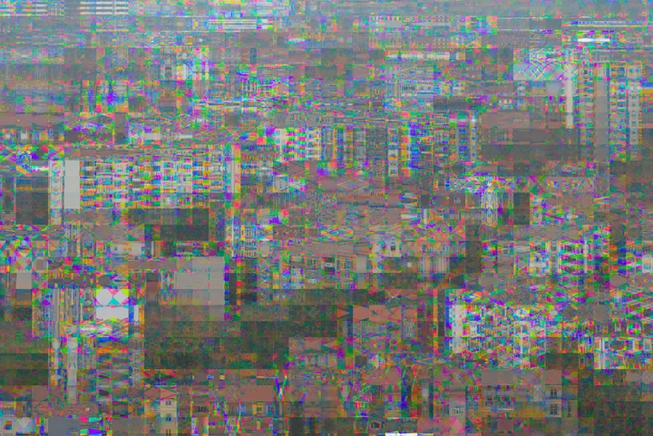
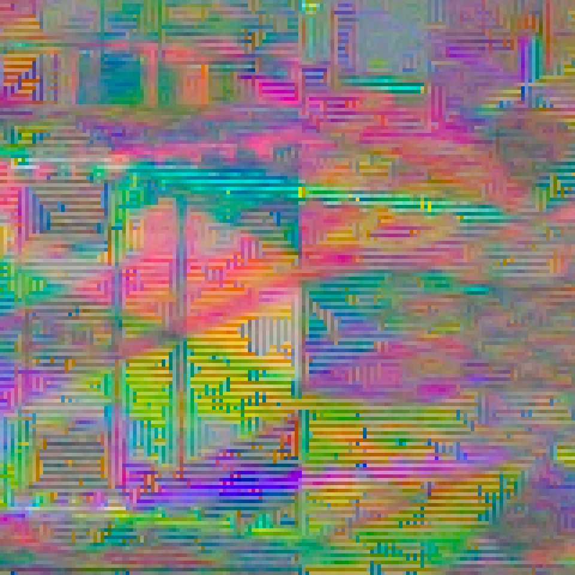
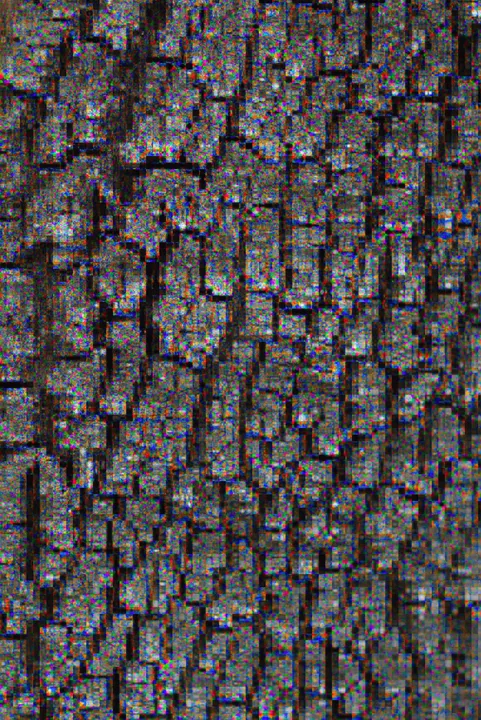
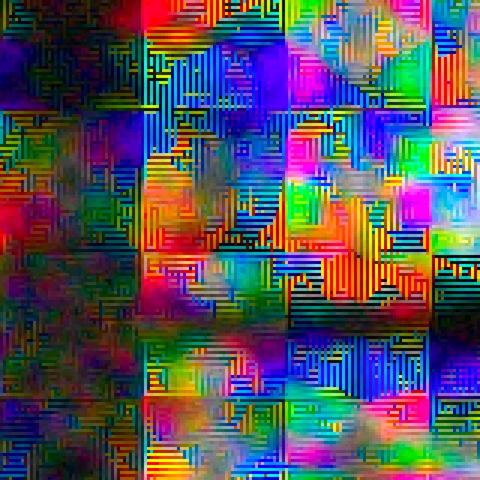
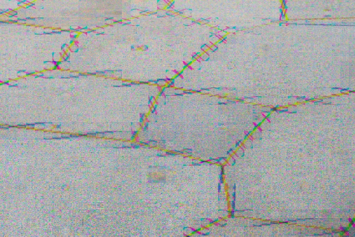
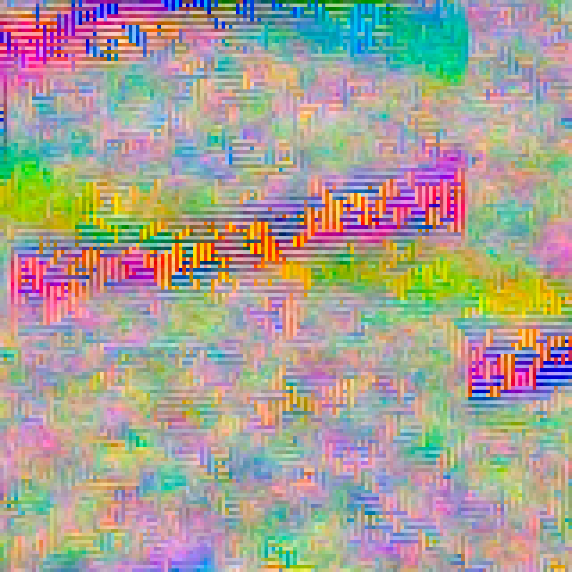

# Bayer Drift

**Make the sensor glitch on purpose. Keep the result in RAW.**

Bayer Drift is a creative [Magic Lantern](https://www.magiclantern.fm/) module by **Max Seelig (MAXmade)** for the original **Canon EOS M**. It shifts the registration of the sensor's colour samples in small repeating tiles, producing false colour, beaded edges and patterned interference. Take a photograph with the normal shutter button: the effect is saved in the **Canon CR2 RAW file**.

[**Explore the photographs & zoom into the details**](https://bayer-drift.netlify.app/) · [Download 0.1.0](https://github.com/m-a-x-s-e-e-l-i-g/bayer-drift/releases/tag/v0.1.0) · [Start shooting](#start-shooting) · [Settings](#settings) · [Build from source](docs/building.md)

Developed and tested on the original EOS M by Max Seelig. These examples are developed from the original camera-processed CR2 files.

## From the EOS M

Full photographs on the left; matching **160 × 160 pixel crops**, enlarged with nearest-neighbour scaling, on the right. Select an image to open the larger version, or use the landing page's **[2× / 4× / 8× pixel viewer](https://bayer-drift.netlify.app/#closer)** to explore the whole photograph. Click or tap anywhere in its left-hand overview to choose a spot, then drag the close-up to pan. Native-resolution tiles load on demand.

| The photograph | Look closer |
|---|---|
|  |  |
|  |  |
|  |  |

Photographs © Max Seelig (MAXmade). These are RAW developments with camera white balance, not a LiveView simulation. No extra glitch filter is added for the showcase. Colours depend on RAW development; recipe settings were not supplied and are not inferred. See the [image provenance and processing notes](site/assets/photos/README.md).

## What does it do?

- Rearranges original 14-bit samples within their own Bayer colour planes.
- Creates repeating colour fringes and interference around details and edges.
- Offers three presets, manual controls and a stable Shuffle recipe.
- Uses the normal shutter, autofocus, Canon RAW saving, review and playback.
- Remembers the effect state and recipe after restart.

There is no AI image generation, added random noise, or conversion to another RAW format. The appearance depends on the scene and the RAW converter's demosaicing and colour processing.

**LiveView remains the normal Canon view.** Compose and focus normally; judge the effect in the captured image. This release has no simulated effect preview and requires no per-frame rendering or preview canvas. Global Draw is not required by Bayer Drift.

## Supported setup

| Requirement | Release target |
|---|---|
| Camera | Original Canon EOS M |
| Canon firmware | 2.0.2 |
| Magic Lantern | EOSM.202 development build, 2025-06-20; module API 8 |
| Shooting | A+ / Auto ISO / Canon RAW / single-shot drive |
| Display | Native 1× LCD view |

Other camera models, other ML builds, movie recording and bursts are not supported by this release. Magic Lantern must already be installed; this download contains an add-on module and does not replace Canon firmware or the ML core. See the [official EOS M page](https://builds.magiclantern.fm/EOSM.html) for Magic Lantern installation.

## Start shooting

1. Download and unzip **[BAYER-DRIFT-0.1.0-EOSM202.zip](https://github.com/m-a-x-s-e-e-l-i-g/bayer-drift/releases/download/v0.1.0/BAYER-DRIFT-0.1.0-EOSM202.zip)**.
2. **Power the camera OFF.** Copy `bayer.mo` from the ZIP's `ML/MODULES` folder into `ML/MODULES` on your card.
3. In Magic Lantern's **Modules** tab, enable `bayer.mo`. Disable Mirror Worlds and other MAXmade effects, then restart the camera.
4. Use the supported setup above. Open **Shoot → Bayer Drift → Photo effect ON**.
5. Choose a preset or adjust the recipe. Close the menu, wait for **ON - Ready**, compose and focus normally, then press the physical shutter.
6. Release the shutter between photographs. Canon handles saving, immediate review and Play/gallery.

Keep the original CR2 files when comparing recipes. Camera review and desktop RAW converters can render the colours differently.

## Settings

| Setting | Choices | What it changes |
|---|---|---|
| Photo effect | OFF / ON | Enables the effect for RAW photographs |
| Preset | Subtle / Crunchy / Overdrive / Custom | A starting recipe |
| Strength | 1–8 | Local sample displacement |
| Pattern | Dots / Horizontal / Vertical | Both axes, horizontal only, or vertical only |
| Texture size | Fine / Medium / Coarse | The span of the repeating sample tiles |
| Phase | 1–4 | Which colour-sample rows and columns move |
| Shuffle | Press SET | Chooses a new recipe and keeps it until you change it |

Editing a preset selects Custom. Settings save automatically. The first physical half/full shutter press freezes the recipe for that shot; changes made during a focus hold apply to later photographs.

## Troubleshooting

If the module reports a capture error, retain the menu reason; OFF/ON retries. For memory issues, disable other modules and restart. This release uses a 39,600-byte RAW workspace and retains the existing memory reserve and allocation checks.

Power OFF before replacing or removing the module. Runtime capture hooks remain resident until restart. To stop using the effect, set Photo effect OFF; to unload it, disable the module and restart.

Report problems in [GitHub Issues](https://github.com/m-a-x-s-e-e-l-i-g/bayer-drift/issues), including camera/firmware, ML build, recipe settings, menu error and reproduction steps. An original CR2 helps investigate image differences.

## Source and validation

The release ZIP includes the module, guide, complete project source, build/import audit and automated test logs. Source and build instructions are also available in this repository. Automated fixtures cover RAW sample correctness, full EOS M geometry, settings, shutter ownership, cancellation, memory handling and execution of the built module on two emulated ARM CPU models. Emulator results are separate from the owner's camera confirmation; see [validation notes](docs/validation.md).

Bayer Drift grew out of an accidental Bayer-registration effect encountered while developing [Mirror Worlds](https://github.com/m-a-x-s-e-e-l-i-g/mirror-worlds). It shares capture infrastructure and helpers with that project. Legacy preview helpers remain in the source for regression/history; they are not linked into the released module.

Licensed under **GPL-2.0-or-later**. See [COPYING](COPYING). Magic Lantern and upstream contributors retain their respective copyright notices.
